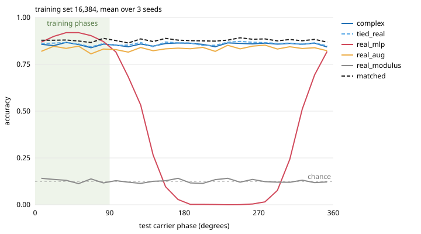

# Phase generalisation: what complex weights buy over real ones

`phase_generalisation.py` is a small PyTorch benchmark (CPU, about two minutes) for the claim "real-valued networks
are all you need". It isolates the one property complex arithmetic gives for free: **equivariance to a global phase
rotation** z → e^{iθ}z. That is the physics of any signal received with an unknown carrier phase: IQ baseband, MRI
k-space, a wavefunction.

## Task

Each sample is one of K = 8 constant-modulus waveforms (n = 32 unit-modulus samples with random phases, like a
PSK/FM burst). It arrives with an unknown carrier phase θ, a random amplitude in 0.5–1.5 and complex Gaussian noise
at −6 dB per sample. The label is which waveform it is, which does not depend on θ.

**Training uses phases in [0°, 90°) only; the test sweeps the full circle.** A model that has the symmetry generalises
to the three quarters it never saw; a model that has to learn the symmetry from data cannot.

## Models

Every learned model has about 8.6k parameters, counted as real degrees of freedom (a complex weight counts as two
reals). Learning rate, epochs and batch size are the same for all models; none were tuned per model.

| model | what it is |
|---|---|
| `complex` | Complex-linear layers without bias, modReLU activations, and a Born read-out p_k = \|z_k\|² / Σ\|z\|². Phase-invariant by construction. |
| `tied_real` | The same network written in real tensors only, each complex weight a tied 2×2 block [[a, −b], [b, a]]. |
| `real_mlp` | ReLU MLP on [Re z, Im z]: the default real network. |
| `real_aug` | The same MLP, trained with phases augmented over the full circle. The symmetry comes in through the data instead of the architecture. |
| `real_modulus` | ReLU MLP on \|z_j\|: a hand-made invariant feature. |
| `matched` | Non-coherent matched filter argmax_k \|⟨s_k, z⟩\| with the true templates. A reference, not a learned model. |

## Results

Means over 3 seeds; the table is `phase_generalisation_results/summary.md`.

| model | 256 train: in / out of range | 1,024 | 4,096 | 16,384 |
|---|---|---|---|---|
| complex | 0.72 / 0.73 | 0.85 / 0.85 | 0.87 / 0.87 | 0.86 / 0.86 |
| tied_real | 0.69 / 0.68 | 0.85 / 0.85 | 0.87 / 0.87 | 0.86 / 0.86 |
| real_mlp | 0.85 / **0.16** | 0.88 / **0.17** | 0.89 / **0.19** | 0.90 / **0.27** |
| real_aug | 0.32 / 0.35 | 0.69 / 0.71 | 0.80 / 0.81 | 0.83 / 0.84 |
| real_modulus | 0.13 / 0.13 | 0.13 / 0.13 | 0.13 / 0.13 | 0.13 / 0.13 |
| matched filter | 0.88 / 0.88 | (no training) | | |

Chance is 0.125.



What the results show:

- **The plain real MLP fails outside its training phases.** It fits the training quarter well, then collapses: the
  phase bins around 180° are at **0.00**. That is worse than chance because a rotation by π negates the input, so the
  network confidently picks a wrong class. More data does not fix it (0.16 → 0.27 out of range from 256 to 16k
  samples).
- **The complex net is flat around the circle.** Its accuracy is the same at every phase. A rotation changes its
  output probabilities by at most 3×10⁻⁶, which is float32 rounding. At 1k samples it is within 0.03 of the matched
  filter.
- **Augmentation fixes generalisation but costs data.** The augmented real MLP needs 16k samples to reach 0.83 and
  still trails the complex net trained on 1k (0.85). With 256 samples it reaches 0.32 against 0.72. Here the symmetry
  prior is worth more than a 16-fold increase in data.
- **The tied 2×2 real net equals the complex net** within seed noise. So the honest claim is not "complex numbers beat
  real numbers". It is "the right symmetry prior beats learning it from data", and complex arithmetic is the cheapest
  way to write the U(1) prior.
- **Naive invariance is not enough.** Feeding |z| makes the model invariant but throws away the relative phases that
  carry the label, so it sits at chance. The invariance has to keep relative phase and remove only the global phase,
  which is what the Born read-out does.
- **The real MLP beats the matched filter inside its range (0.89–0.90 against 0.88).** This is not a flaw. Knowing
  that θ lies in a quarter circle lets it do partly coherent detection, which beats the non-coherent optimum. It shows
  the real MLP is a strong learner; it just learned the wrong invariance.

## What a skeptic can still say, and the answer

- *"With enough augmented data the real net gets there."* True: the gap is sample efficiency plus an exact guarantee.
  It is not expressivity.
- *"The tied net is a real net."* Yes. That is the point: the gain comes from the structure, and complex arithmetic
  is how you write that structure without thinking about it.
- *"Your data has no phase symmetry."* Then complex weights give nothing beyond twice the real width. This benchmark is
  about phasic data, where they do.
- *"Hyperparameters were not tuned per model."* They were not. Tuning the real MLP could raise its in-range accuracy,
  but no learning rate makes a network that never saw θ ≈ 180° invariant to it.

## Running it

```
python3 phase_generalisation.py                               # 4,096 training samples, 3 seeds, ~20 s
python3 phase_generalisation.py --sweep 256,1024,4096,16384   # the table above, ~2 min
python3 phase_generalisation.py --train_phase 180 --snr_db -3 --k 16 --out my_run
```

The script needs only PyTorch. It writes `results.csv` (accuracy per model, seed, training size and phase bin),
`summary.md` and `accuracy_vs_phase.svg` to `--out`.
