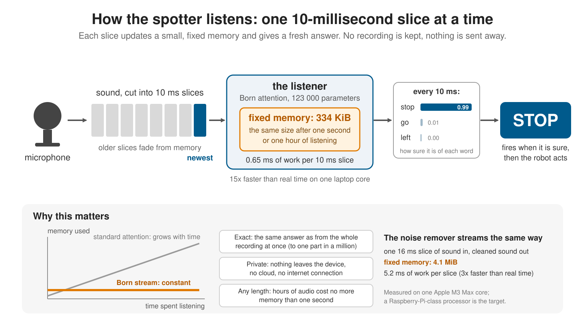

# Voice demo: streaming command spotting and noise removal on a CPU

A self-contained demo of two small speech models built with Born attention in CNet and run as constant-state
streams: a command spotter (35 words, 123k complex parameters) and a noise remover (721k parameters). The
three-page deck in `presentation/voice_demo.pdf` says the same as this page for a non-technical reader.

## 1. The technology in one page



A small robot, a wearable or an appliance has to hear you continuously, with no cloud link, no graphics chip and
a small battery. Today's best speech models are built for short clips: either they re-read the whole last second
at every step, or they stream over a fixed window that forgets abruptly.

Born attention weighs earlier sound frames by a probability, as a measurement does in quantum physics. Its kernel
has an exact recurrence (as other linear-attention kernels do, and softmax attention does not), so the model runs
one 10-millisecond frame at a time with a memory that never grows, and the stream computes exactly what the same
model computes from the whole recording at once.

What the stream costs on one Apple M3 Max core (the target, a Raspberry-Pi-class processor, is not yet measured):

| | Spotter | Noise remover |
|---|---|---|
| memory kept between frames | 334 KiB | 4.1 MiB |
| compute per frame | 0.65 ms per 10 ms of audio | 5.2 ms per 16 ms |
| faster than real time | 15x | 3x |
| agreement with the offline model | one part in a million | one in 100,000 |
| model file | 1.4 MB | 6.8 MB |

Against the alternatives: standard transformers grow their memory with time or forget abruptly at a window
edge; other linear-attention kernels also keep a constant memory, and in our matched training runs the Born
kernel was ahead of a gated-linear one at every checkpoint on spotting and at 48 of 50 on denoising; removing
attention altogether costs 15 points of accuracy.

## 2. What two days produced (20 to 22 November 2026)

Both models were trained from the raw waveform on one rented GPU in our own framework (CNet, C++/CUDA, complex
numbers built in), then rebuilt as streams and run on a plain CPU.

- **Command spotter**, Google's 35-word Speech Commands benchmark: the r28 model gets 95.1% of test clips
  correct with 123k parameters, within one point of the standard reference model of the same size and within
  2.5 points of the best published results, which train four to five times longer or start from large pretrained
  models. A separate rejection-trained model, r21 (17 classes: 15 commands, unknown, silence), detected 114 of
  143 commands with six false accepts in a 15.2-minute synthetic stream at 20 dB SNR; `listen.sh` runs r28
  filtered to seven words, `listen.sh --robot` runs r21.
- **Noise remover**, VoiceBank-DEMAND: speech quality score (PESQ, 1 to 4.5) from 1.97 to 2.60 and a 9.3 dB
  improvement in SI-SDR (the signal-to-distortion ratio); the stream matches the offline version within 0.02 of
  the PESQ score. Those scores use a fixed input gain; `denoise.sh` streams with a causal running gain, the
  setting a device would use, which costs about 0.07 PESQ. The gap to the best published models is 0.3 to 0.6 on
  the scale, and the lever that moves it is known.
- **Why it matters**: built for a Raspberry-Pi-class processor, with nothing leaving the device and a constant
  cost per second however long it listens; one stack from training to a 0.4 MB program plus the model file; 36
  documented training runs and a 23-page technical report with the failures as well as the results.
- **Next**: measure on the robot's processor, train the spotter directly on continuous audio, the extra loss
  term for the noise remover, repeat the key comparisons with several random seeds.

## 3. Build and run

You need a Mac (Xcode command-line tools and `brew install libomp`) or a Linux machine (`g++`, `make`,
`python3-venv`, `libportaudio2` for the microphone), Python 3, and a microphone.

```sh
git clone https://github.com/crasmarum/CNet.git
cd CNet/voice_demo
./build.sh          # the four CPU programs into bin/, a Python environment into .venv/ (about two minutes)
./play_demo.sh      # the bundled noisy clip, then the cleaned version from the stream
./listen.sh         # r28 listening for stop, go, left, right, forward, backward, follow; Ctrl-C stops
./listen.sh --robot # r21, the model behind the continuous-audio numbers
./denoise.sh        # record 5 s with some background noise, hear the recording and the cleaned version
```

`listen.sh` prints a time and a word each time a command is detected, in CAPITALS when the model is sure, and
twice a second its current best guess. Variants: `./listen.sh --robot` (r21), `./listen.sh --all` (any of the 35 words), `./listen.sh --ptt`
(press Enter, say a word, see the top guesses), `./denoise.sh --file your.wav` (a 16 kHz mono WAV instead of the
microphone), `./denoise.sh --offline` (the offline path with overlapping two-second windows), `./denoise.sh
--no-play`, `./play_demo.sh --no-play`.

The scripts work from the public CNet repository (this folder next to the Makefile) and from the research tree
(next to `src/`). `./build.sh --clean` starts over.

## What is in the folder

| path | what |
|---|---|
| `build.sh`, `listen.sh`, `denoise.sh`, `play_demo.sh` | the demo |
| `models/r28_e37.mod`, `models/labels.txt` | the benchmark spotter (best-validation checkpoint of run r28) and its 35 labels |
| `models/r21_e24.mod`, `models/labels17.txt` | the robot's 17-class spotter (run r21, epoch 24) behind the continuous-audio numbers |
| `models/s8_e49.mod` | the noise remover (run s8) |
| `py/kws_listen_stream.py`, `py/kws_mic.py`, `py/se_mic.py` | microphone scripts (copies of `src/data/`) |
| `clips/clip2_noisy.wav` | a seven-second VoiceBank-DEMAND test recording (CC BY 4.0), see `clips/README.md` |
| `presentation/voice_demo.tex`, `voice_demo.pdf` | the three-page deck |
| `presentation/streaming_overview.svg`, `.png`, `.pdf` | the one-picture explanation of the stream (above) |

The programs are `examples/kws_stream.cpp`, `examples/se_stream.cpp` (the streaming twins), `examples/kws_infer.cpp`
and `examples/se_infer.cpp` (offline), built by the CNet Makefile without CUDA. The technical report is
`kws_paper/kws_born.tex` in the research tree.
